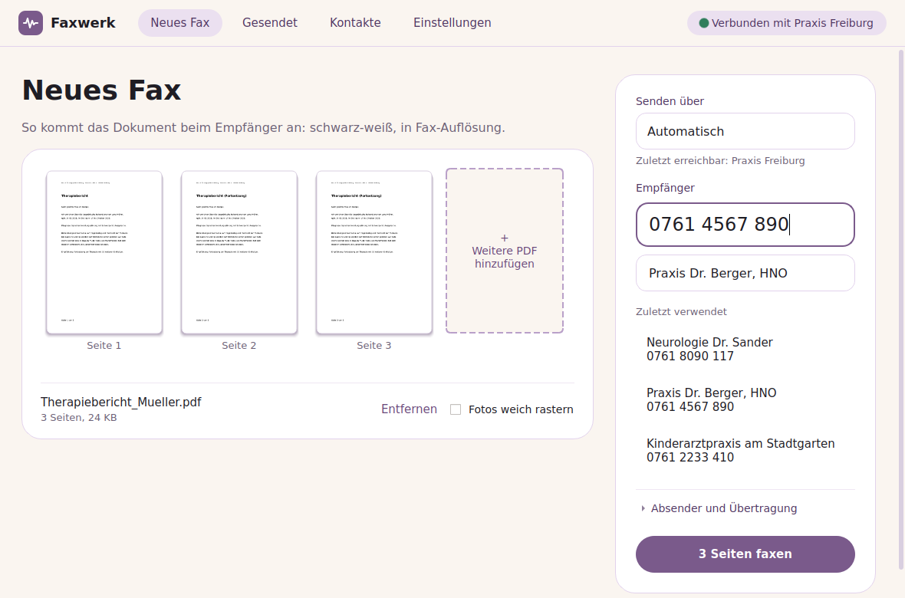
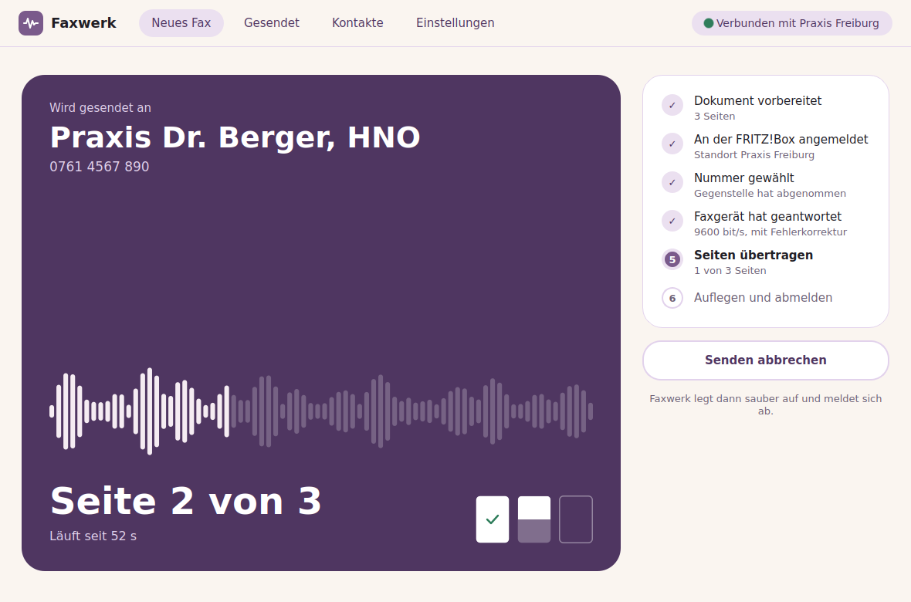
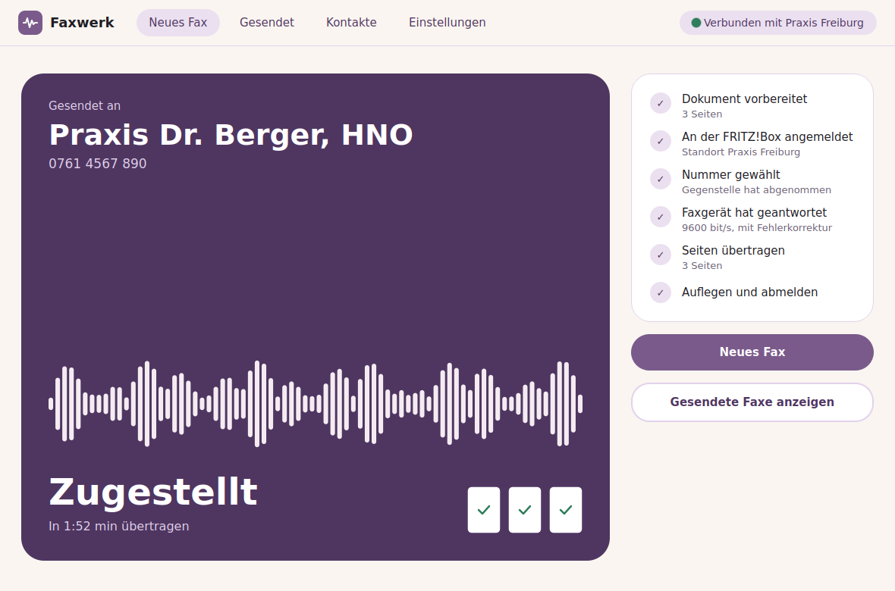
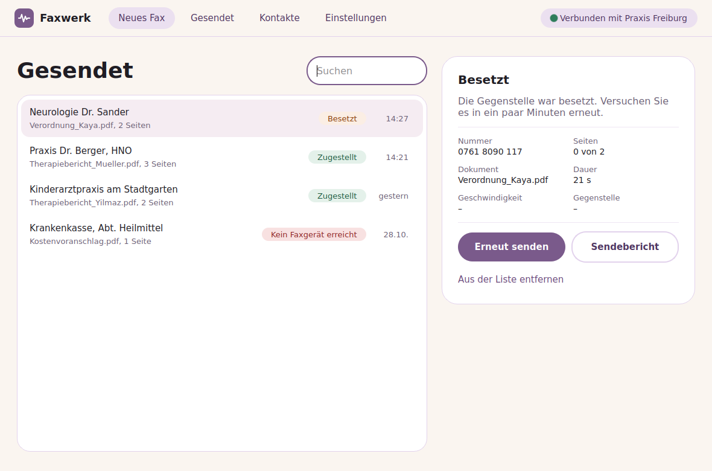
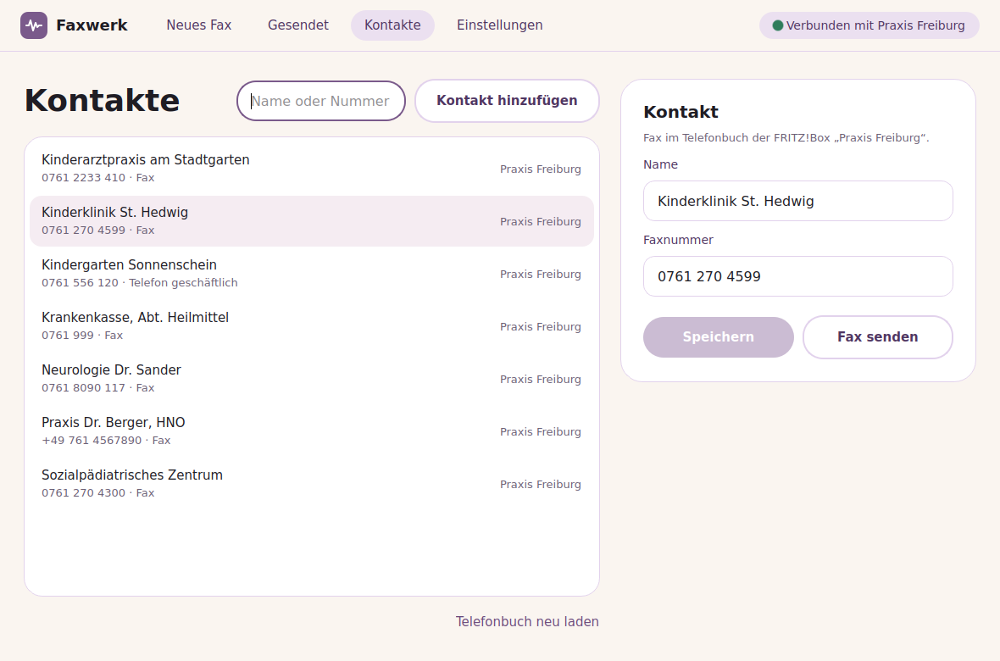
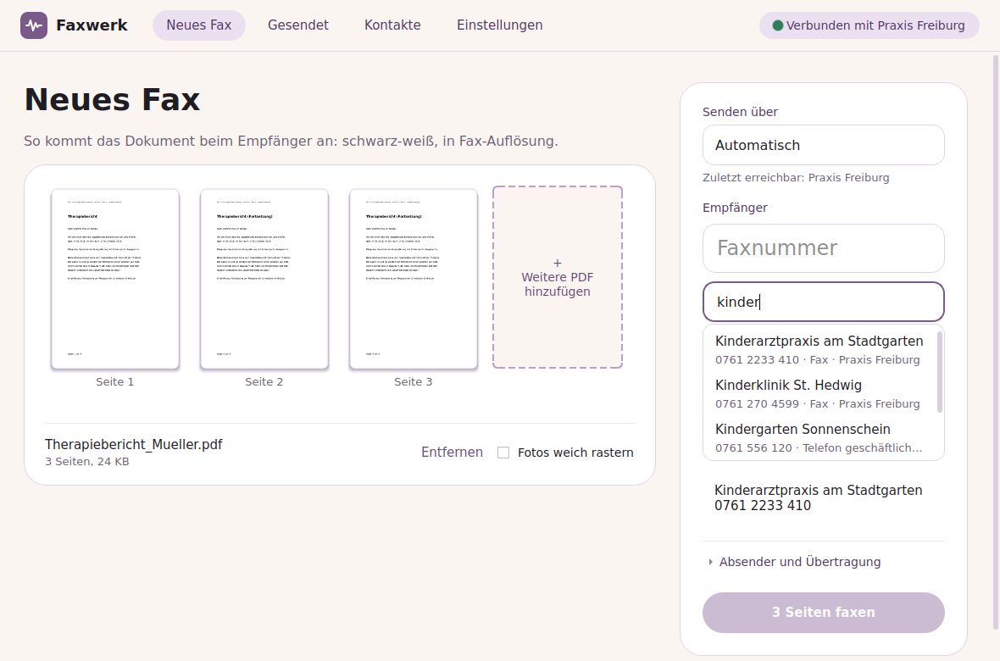
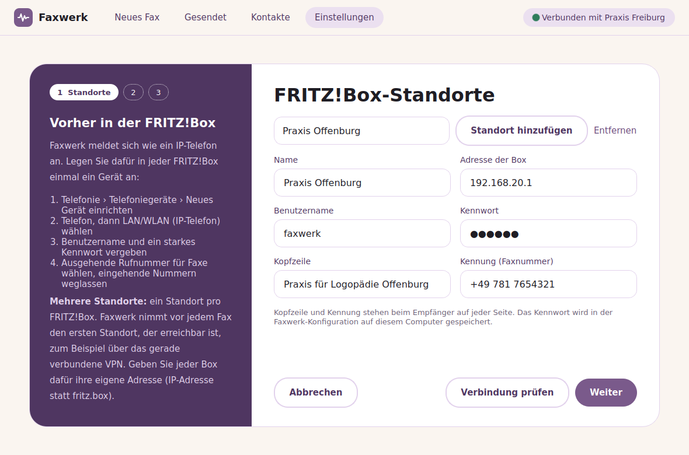

# Faxwerk

Faxwerk sends PDF documents as a fax through a home router that offers IP telephony,
such as an AVM FRITZ!Box. It registers with the router over SIP as an IP phone, dials the
destination and runs the T.30 fax protocol in software (spandsp) over a G.711 audio
stream. You don't need a fax modem, an ISDN card or CAPI.

Windows and macOS are the target platforms, with installers for both. Development
happens on Linux in a Docker dev container, and there is a Linux AppImage as well.



> **Status:** desktop app (Qt Widgets, German user interface) and command line tool.
> T.38 is planned. The architecture has a replaceable transport backend for it (see
> [Architecture](#architecture)).

*FRITZ!Box is a trademark of AVM GmbH. Faxwerk is not affiliated with AVM. The product
name is set with the CMake cache variable `FAXWERK_PRODUCT_NAME` (default `Faxwerk`), and
CMake refuses names that contain "FRITZ".*

---

## Contents

- [Features](#features)
- [Building in the dev container (Linux)](#building-in-the-dev-container-linux)
- [Building against upstream spandsp](#building-against-upstream-spandsp)
- [Packages and installers](#packages-and-installers)
- [Setting up the FRITZ!Box](#setting-up-the-fritzbox)
- [First practical test](#first-practical-test)
- [Desktop app](#desktop-app)
- [Command line reference](#command-line-reference)
- [Configuration file](#configuration-file)
- [Exit codes](#exit-codes)
- [Architecture](#architecture)
- [Tests](#tests)
- [Known limitations and risks](#known-limitations-and-risks)
- [Licensing](#licensing)

## Features

- Its own minimal SIP stack (RFC 3261) on `QUdpSocket`. It does not use PJSIP.
  - REGISTER with digest authentication (MD5, MD5-sess, SHA-256, qop `auth` or none),
    refresh at Expires/2, unregister on exit
  - INVITE with 401/407 handling (ACK, then a new INVITE with CSeq+1), correct ACK rules for
    2xx and non-2xx, retransmission timers A/B and E/F, CANCEL and BYE
  - Handles incoming OPTIONS, BYE, NOTIFY, re-INVITE and UPDATE. T.38 re-INVITEs are declined
    with `488 Not Acceptable Here`, and the fax continues on G.711.
- RTP with G.711 A-law (preferred) or µ-law, 20 ms packets, drift-free pacing, gap concealment
- T.30 via spandsp: ECM (on by default), V.27ter/V.29 up to 9600 bit/s by default, V.17 up to
  14400 bit/s optionally, station ID and page header
- PDF rasterization with QtPdf at 204×196 dpi on 1728-pixel lines (landscape pages are
  rotated), with a threshold for text or Floyd-Steinberg dithering for images
- Supports both spandsp API generations: 0.0.6 (Debian/Ubuntu) and upstream 0.0.7/3.x
  (needed on Windows/macOS)

## Building in the dev container (Linux)

Requirements: Docker (or Podman via `DOCKER=podman`).

```sh
scripts/dev.sh            # build image, configure, build (-Werror), run ctest
scripts/dev.sh test       # configure + build + ctest (image must exist or is built)
scripts/dev.sh shell      # interactive shell in the container
scripts/dev.sh run register-test --user faxwerk620   # run the CLI in the container
```

The script mounts the repository at `/workspace`, runs as your uid/gid and builds into
`build/container-debug`. `BUILD_TYPE=Release scripts/dev.sh` builds a release version.

**VS Code:** open the folder and choose *Reopen in Container*. `.devcontainer/devcontainer.json`
uses the same Dockerfile.

**Networking:** SIP and RTP must reach the router in your LAN, and the router's replies must
reach the container. Both `scripts/dev.sh` and the devcontainer run the container with
`--network=host`. This works on a **Linux** Docker host. Docker Desktop on macOS/Windows
cannot share the LAN this way, so build natively there for real tests (the unit tests work
anywhere).

The image is based on `ubuntu:24.04` with `build-essential cmake ninja-build git gdb
pkg-config qt6-base-dev qt6-pdf-dev libspandsp-dev libtiff-dev`. It also contains
`qt6-qpa-plugins` and `fonts-dejavu-core` (offscreen platform and fonts for `QPdfWriter`
in the tests), `libtiff-tools` for debugging, and the autotools that upstream spandsp needs.

Manual build inside the container:

```sh
cmake -S . -B build -G Ninja -DCMAKE_BUILD_TYPE=Debug -DFAXWERK_WERROR=ON
cmake --build build
ctest --test-dir build --output-on-failure
```

## Building against upstream spandsp

Ubuntu ships spandsp 0.0.6. Windows and macOS builds need upstream spandsp
([freeswitch/spandsp](https://github.com/freeswitch/spandsp)), which uses different callback
signatures. CMake detects the API with `check_cxx_source_compiles` (`cmake/SpanDspApi.cmake`)
and defines `FAXWERK_SPANDSP_NEW_API` (and `FAXWERK_SPANDSP_LOG_USER_DATA`).

To build upstream spandsp in the container and then build and test Faxwerk against it:

```sh
scripts/dev.sh upstream            # optional argument: git ref, default master
```

The script clones spandsp to `build/upstream/spandsp`, installs it to
`build/upstream/prefix`, configures Faxwerk with `CMAKE_PREFIX_PATH` pointing there, checks
that the new API was detected and runs ctest.

## Packages and installers

Windows and macOS are the main targets. Each platform has one script that builds the
working tree, runs the tests and packages the result into `out/`:

| Platform | Command | Result |
|----------|---------|--------|
| Windows | `scripts/package-windows.sh` (MSYS2 UCRT64 shell) | `Faxwerk-<version>-windows-x64-setup.exe` |
| macOS | `scripts/package-macos.sh` | `Faxwerk-<version>-macos-<arch>.dmg` and `.pkg` |
| Linux | `scripts/dev.sh appimage` (dev container) | `Faxwerk-<version>-x86_64.AppImage` |

The version comes from `git describe`. Windows and macOS have no usable spandsp
package, so both scripts first build upstream spandsp with `scripts/build-spandsp.sh`
into `build/spandsp/prefix` (set `SPANDSP_REF` to pin a commit). `SKIP_TESTS=1` skips
ctest.

`.github/workflows/build.yml` runs all three on GitHub for every push and pull request
and attaches the packages to the run. A tag `v*` also creates a GitHub release with all
of them.

### Windows

Install [MSYS2](https://www.msys2.org) and [Inno Setup 6](https://jrsoftware.org/isinfo.php),
then in the *MSYS2 UCRT64* shell:

```sh
pacman -S --needed git make which diffutils autoconf automake libtool \
    mingw-w64-ucrt-x86_64-{toolchain,cmake,ninja,pkgconf,libtiff,qt6-base,qt6-pdf}
scripts/package-windows.sh
```

The script copies the programs into `build/windows/dist`. `windeployqt` adds Qt to that
folder, and the script then adds every other DLL the programs load (the MinGW runtime,
spandsp, libtiff and their dependencies). The folder runs as it is. Inno Setup
(`packaging/windows/faxwerk.iss`) turns it into an installer with a German and an
English user interface. The installer:

- installs to `C:\Program Files\Faxwerk`,
- adds a Start menu entry and an optional desktop icon,
- adds "Open with" for PDFs (it doesn't become the default PDF viewer),
- adds a firewall rule that allows incoming UDP for `faxwerk-gui.exe` and `faxwerk.exe`
  in private networks (the router sends SIP requests and RTP audio to Faxwerk),
- removes all of this again when it is uninstalled.

The installer isn't signed, so Windows SmartScreen warns the first time it runs:
*Weitere Informationen › Trotzdem ausführen*.

**Building on Linux in a Windows VM.** `scripts/windows-vm.sh` runs Windows 11 in Docker
([dockur/windows](https://github.com/dockur/windows), needs KVM) and builds the working
tree there, including uncommitted changes:

```sh
scripts/windows-vm.sh up      # first time: downloads and installs Windows, MSYS2 and Inno Setup (30–60 min)
scripts/windows-vm.sh build   # installer in out/windows/
scripts/windows-vm.sh stop
```

The VM's screen is at http://127.0.0.1:8006 (user and password `faxwerk`) for trying the
installer. Disk and SSH key live in `~/.local/share/faxwerk-windows-vm`.

### macOS

Install Homebrew and the Xcode command line tools (`xcode-select --install`), then:

```sh
brew install qt libtiff jpeg-turbo autoconf automake libtool ninja pkgconf cmake
scripts/package-macos.sh
```

The result is `build/macos/dist/Faxwerk.app`, a disk image and an installer package
(`.pkg`, installs the app into `/Applications`). `macdeployqt` copies Qt,
spandsp and libtiff into the bundle. The command line tool is inside the bundle at
`Faxwerk.app/Contents/Helpers/faxwerk`; the installer package also puts a small
`/usr/local/bin/faxwerk` script in place that starts it (an existing
`/usr/local/bin/faxwerk` from elsewhere is left alone). The bundle declares PDF as a document type
("Open with" in Finder). It also has the local network usage text that macOS 15 and
later show before the app may reach the router.

**Installing on macOS without a Developer ID.** Without an Apple Developer ID
certificate, the app is only signed ad hoc and not notarized. Gatekeeper blocks the
first start of a downloaded copy:

1. Open the disk image and drag *Faxwerk* to *Programme*.
2. Start it once. macOS refuses to open it.
3. Go to *Systemeinstellungen › Datenschutz & Sicherheit* and choose *Dennoch öffnen*
   (on macOS 14 a right click on the app › *Öffnen* is enough).

With the installer package (`.pkg`) it works the same way: macOS refuses to open the
unsigned package, *Dennoch öffnen* in *Datenschutz & Sicherheit* allows it. The installed
app then starts without a further warning, because the installer sets no quarantine
flag. With a "Developer ID Installer" certificate, `PKG_SIGN_IDENTITY` signs the package.

Alternatively remove the quarantine flag in the terminal:
`xattr -dr com.apple.quarantine /Applications/Faxwerk.app`. A copy built on the Mac
itself with `scripts/package-macos.sh` has no quarantine flag and starts directly.

The GitHub build runs on Apple Silicon with Homebrew's libraries, so that disk image
needs an Apple Silicon Mac with macOS 15 or newer. For an Intel Mac or an older macOS, run the script on
that Mac.

### Linux AppImage

```sh
scripts/dev.sh appimage
```

This builds a release version in the dev container and packages it with
[linuxdeploy](https://github.com/linuxdeploy/linuxdeploy) and its Qt plugin. The script
downloads both into `build/appimage/tools` on the first run. The AppImage starts the
desktop app, and the command line tool is in it as `usr/bin/faxwerk`. The container is
Ubuntu 24.04, so the AppImage needs glibc 2.39 or newer.

The AppImage carries update information for
[AppImageUpdate](https://github.com/AppImageCommunity/AppImageUpdate): it looks for new
versions in the latest GitHub release of this repository
(`gh-releases-zsync|dschlegel|faxwerk|latest|Faxwerk-*-x86_64.AppImage.zsync`). The script
also writes a `.zsync` file next to the AppImage; both are attached to the release.

`FAXWERK_UPDATE_INFORMATION` overrides this, e.g. for a fork or your own server, and
`none` builds without update information:

```sh
FAXWERK_UPDATE_INFORMATION='zsync|https://example.org/faxwerk/Faxwerk-latest-x86_64.AppImage.zsync' \
    scripts/dev.sh appimage
```

On GitHub the repository variable `FAXWERK_UPDATE_INFORMATION` does the same.

The desktop app updates itself with
[libappimageupdate](https://github.com/AppImageCommunity/AppImageUpdate): a few seconds
after the start it checks the update information in the background, and when a new
release is there, an "Update verfügbar" button appears in the top bar. It downloads only
the changed blocks, puts `Faxwerk-<new version>-x86_64.AppImage` next to the old file,
removes the old one and offers a restart. The dev container builds libappimageupdate
from source into `/usr/local`; the CMake option `FAXWERK_APPIMAGEUPDATE` (`AUTO`, `ON`,
`OFF`) controls whether it is used. Outside an AppImage (`$APPIMAGE` not set) the app
does not look for updates.

### Updates and releases

The desktop app looks for a new version a few seconds after the start and then shows an
"Update auf <version>" button in the top bar:

| Platform | How |
|----------|-----|
| Linux AppImage | libappimageupdate, see above |
| Windows | latest GitHub release: downloads `Faxwerk-<version>-windows-x64-setup.exe` and starts it |
| macOS | latest GitHub release: downloads the `.pkg` (otherwise the `.dmg`) and opens it |

Windows and macOS ask `https://api.github.com/repos/<repository>/releases/latest` and
compare the tag (`v0.2.0`) with the version of the build, i.e. `project(... VERSION)` in
`CMakeLists.txt`. The download is checked against the size and the SHA-256 digest GitHub
lists for the file. The repository is the CMake cache variable `FAXWERK_UPDATE_REPOSITORY`
(default `dschlegel/faxwerk`, empty disables the check). The environment variable
`FAXWERK_NO_UPDATE_CHECK` switches the check off on all platforms. The repository must be
public; drafts and pre-releases are not offered.

A release:

1. Raise `VERSION` in `CMakeLists.txt` (e.g. to `0.2.0`) and merge to `main`.
2. Tag that commit with the same version and push the tag:
   `git tag v0.2.0 && git push origin v0.2.0`.
3. The GitHub workflow builds all packages and publishes them as release `v0.2.0`.

### Building by hand

The scripts above wrap these steps. With spandsp installed in a prefix:

```sh
cmake -S . -B build -G Ninja -DCMAKE_BUILD_TYPE=Release \
    -DCMAKE_PREFIX_PATH="<Qt>;<libtiff>;<spandsp prefix>"
cmake --build build
ctest --test-dir build --output-on-failure
```

On macOS the Qt and libtiff prefixes are `$(brew --prefix qt)` and
`$(brew --prefix libtiff)`. In MSYS2 only the spandsp prefix is needed. MSVC also works
when spandsp is built separately: `FindSpanDSP.cmake` falls back to
`find_path`/`find_library` without pkg-config and honors `SpanDSP_ROOT`.

## Setting up the FRITZ!Box

Create an IP phone for Faxwerk in the FRITZ!Box web interface (wording from current
FRITZ!OS versions; older versions differ slightly):

1. **Telefonie → Telefoniegeräte → Neues Gerät einrichten**
2. Choose **Telefon (mit und ohne Anrufbeantworter)**, then **LAN/WLAN (IP-Telefon)**, and give it a
   name such as "Faxwerk".
3. Set a **Benutzername** (user name) and a strong **Kennwort** (password). Faxwerk uses
   these as `--user` and the password.
4. Choose the **outgoing number** for faxes. Incoming calls are not needed: Faxwerk rejects
   them with `486 Busy Here`, so don't assign incoming numbers if the dialog allows it.
5. Finish the wizard. The registrar is `fritz.box` (or the box's IP, for example
   `192.168.178.1`) on port 5060.

## First practical test

1. **Check the registration:**

   ```sh
   export FAXWERK_PASSWORD='the password from step 3'
   faxwerk register-test --server fritz.box --user faxwerk620 --sip-trace register.log
   ```

   A successful run prints `OK: registered as faxwerk620@fritz.box (expires … s, …)`. The
   phone shows up as registered in the FRITZ!Box for a moment and then unregisters. Exit
   code 5 means the user name or password is wrong.

2. **Send a test fax** to a fax machine you control or to a fax test service:

   ```sh
   faxwerk send --server fritz.box --user faxwerk620 \
       --to 0301234567 --pdf letter.pdf \
       --ident "+49 30 1234567" --header "Example Ltd." \
       --sip-trace send.log --verbose
   ```

   `--sip-trace` records every SIP datagram (digest hashes only, never the password).
   `--verbose` adds the T.30 log. If something fails, attach both to the bug report. If the
   transfer is unreliable, try `--no-ecm` or check that the router does not switch the call to
   T.38 (see below).

To check how a PDF will look as a fax without sending it:

```sh
faxwerk render --pdf letter.pdf --out letter.tif [--dither]
```

## Desktop app

`faxwerk-gui` (`Faxwerk.app` on macOS) uses the same configuration file as the command
line tool. On the first start it opens a short setup in three steps: the routers (IP
phone credentials with a button that tests the registration, header line and station
ID), an optional FRITZ!Box user for the phonebook, and the transfer options. After that
the app has these screens (later, *Einstellungen* shows the same three parts as tabs
that are saved together):

- **Neues Fax:** PDFs are added with the file dialog, by drag and drop or as command line
  arguments. The pages are shown rasterized the way the recipient will get them. The
  screen also has the recipient number with an optional name and the last used
  recipients. Typing part of a name or number suggests matching contacts from the
  FRITZ!Box phonebook. An unknown number with a name can be saved there with *Als
  Kontakt speichern*.
- **Sending:** the progress of the current fax (sign in, dial, handshake, pages, hang up)
  and the result, with retry and edit actions. Closing the window while a fax is being
  sent hangs up and unregisters first.
- **Gesendet:** every send attempt with its result in plain language, saved in
  `journal.json` in the app data directory (`%APPDATA%\Faxwerk` on Windows,
  `~/Library/Application Support/Faxwerk` on macOS, `~/.local/share/Faxwerk` on Linux). Entries can be sent again or saved as a PDF
  transmission report.
- **Kontakte:** the phonebooks of the routers, with search. Selected entries can be
  changed, and new ones added; both are saved in the FRITZ!Box.

**Keyboard.** Ctrl+1 to Ctrl+4 (⌘ on macOS) open the four pages, Ctrl+N starts a new fax
in the number field, Ctrl+O adds a PDF, F5 (⌘R) looks for the reachable location again.
On macOS the app has a menu bar with these commands, *Einstellungen …* (⌘,) and *Über
Faxwerk*. The app uses the system font of each platform.

| Sending | Result |
| --- | --- |
|  |  |
| **Gesendet** | **Kontakte** |
|  |  |
| **Suggestions while typing** | **Setup** |
|  |  |

**Locations.** The app can send through several routers, for example one per practice
reached over VPN. Each location has its own address, IP phone credentials, header line and
station ID. With automatic selection (the default), the app registers at all locations in
parallel before each fax, unregisters right away and sends through the first location in
list order that accepted the registration. It also does this at start, when the window
comes back to the front (e.g. after switching the VPN), and when the status display in
the top bar is clicked. The status display shows the location it found. A location can
also be chosen for a single fax on the *Neues Fax* screen. For automatic selection, give
every router its own address (its IP address), because `fritz.box` resolves to whichever
router the current DNS server names. The journal and the transmission report record
the location.

Locations are stored in the INI file as the array `[locations]`. The first location is
also written to `[sip]` and `[fax]`, so the command line tool uses it. A configuration
without `[locations]` (for example one written for the command line tool) becomes the
first location.

**Phonebook.** The contacts come from the phonebooks of the FRITZ!Box, read over TR-064
(`http://<router>:49000`, service `X_AVM-DE_OnTel`). That needs a FRITZ!Box user (System ›
FRITZ!Box-Benutzer), not the IP phone credentials. Reading needs the right
„Sprachnachrichten, Faxnachrichten, FRITZ!App Fon und Anrufliste“, saving contacts
„FRITZ!Box Einstellungen“, and *Zugriff für Anwendungen zulassen* (Heimnetz › Netzwerk ›
Netzwerkeinstellungen) has to be on, which is the default. The user is set per location
(`phonebook_user`, `phonebook_password` in `[locations]`). The app reads the phonebook of
the location it finds, at most every 30 minutes and on *Telefonbuch neu laden*, and keeps
a copy in `contacts.json` next to `journal.json`, so the suggestions also work without a
connection. A person with fax numbers is offered with those only; otherwise with their
landline and other numbers. Mobile and internal numbers are left out. When a contact is
changed, the app reads the entry from the router, replaces the name and that one number,
and writes it back, so the entry's other numbers, e-mail addresses and speed dials stay.
New contacts go to the main phonebook (ID 0) of the location found last.

The app stores the SIP and phonebook passwords in the INI file. The colors follow
the Sonara practice website (aubergine `#7a5a8b` on cream `#faf5f0`). The font list starts
with DM Sans and falls back to the system font when DM Sans is not installed.

## Command line reference

```
faxwerk send --to <number> --pdf <file> [--pdf ...]
             [--server fritz.box] [--port 5060] [--domain <domain>]
             [--user <name>] [--auth-user <name>] [--password <secret> | env FAXWERK_PASSWORD]
             [--ident "+49 ..."] [--header "..."] [--max-rate 9600|14400] [--no-ecm]
             [--dither] [--timeout <seconds>] [--local-port N]
             [--sip-trace <file>] [--verbose] [--config <file.ini>]
faxwerk register-test [SIP options as above]
faxwerk render --pdf <file> [--pdf ...] --out <file.tif> [--dither]
```

- Faxwerk takes the password from `--password`, then the `FAXWERK_PASSWORD` environment
  variable, then the INI file. If none of these is set and stdin is a terminal, it asks for
  the password (without echo). `--password` is visible in the process list, so use the
  environment variable. Passwords are never logged.
- `--ident` is the station ID (TSI, at most 20 characters) and `--header` the page header line
  (at most 50 characters).
- `--max-rate 9600` (default) uses V.29/V.27ter, and `14400` also allows V.17. Over IP the
  lower rate is usually more robust.

## Configuration file

The same settings can be stored in an INI file (QSettings). The default path is
`~/.config/Faxwerk/faxwerk.ini` on Linux/macOS and `%APPDATA%\Faxwerk\faxwerk.ini` on
Windows; `--config <file>` picks another one. See
[`docs/faxwerk.ini.example`](docs/faxwerk.ini.example). Command line options override the
file.

## Exit codes

| Code | Meaning |
|-----:|---------|
| 0    | Success |
| 1    | Internal error |
| 2    | Invalid command line or configuration |
| 3    | Document error (PDF unreadable, rendering or TIFF writing failed) |
| 4    | Network error (server not resolvable, port in use, no route) |
| 5    | Authentication failed (wrong SIP user name or password) |
| 6    | Registration failed for another reason (rejected, no answer) |
| 7    | Call failed (busy, number not found, no answer, rejected) |
| 8    | Fax transfer failed (T.30 negotiation or page transfer) |
| 9    | Overall timeout exceeded |
| 130  | Interrupted (Ctrl+C); Faxwerk hangs up and unregisters first |

## Architecture

```
src/core (static library faxwerk_core)
  sip/SipMessage      RFC 3261 parser/serializer
  sip/DigestAuth      digest authentication
  sip/Sdp             SDP offer/answer, T.38 detection
  sip/SipUserAgent    registration, one call, transactions (QUdpSocket)
  rtp/G711, rtp/RtpSession   G.711 codec and RTP endpoint (AudioPort interface)
  fax/FaxEngine       spandsp fax_state in audio mode (implements AudioPort)
  document/PdfRasterizer, document/FaxTiff   PDF -> 1 bit pages -> CCITT G3 TIFF
  transport/FaxTransport       abstract delivery backend
  transport/SipG711Transport   REGISTER -> INVITE -> RTP+FaxEngine -> BYE -> unregister
  FaxJob              rasterize -> transport -> outcome, overall timeout
src/cli               faxwerk executable
src/gui               desktop app (faxwerk_gui_lib + faxwerk-gui), German UI
tests/                QtTest suites incl. MockFritzBox
```

`FaxTransport` is the extension point: a future `T38Transport` (SIP + UDPTL with spandsp's
`t38_terminal`) or a `CapiTransport` (CAPI over TCP, where the router does the modulation)
can be added and chosen in `FaxJob::createTransport()` without changing the CLI.

## Tests

`ctest` runs these suites. All pass in the container with spandsp 0.0.6 and against
upstream spandsp.

| Suite | What it checks |
|-------|----------------|
| `tst_sipmessage` | parsing, compact forms, folding, list headers, Content-Length, roundtrip, name-addr/URI helpers |
| `tst_digestauth` | RFC 2617 vector (Mufasa → `6629fae4…`), nonce count, no-qop, MD5-sess, RFC 7616 SHA-256 |
| `tst_sdp` | offer (PCMA, PCMU, ptime 20, no telephone-event), answer selection, T.38 detection |
| `tst_g711` | A-law/µ-law roundtrip tolerance over the full 16-bit range |
| `tst_rtpsession` | accelerated pacing, gap concealment, late packets, SSRC change |
| `tst_pdfrasterizer` | 3-page PDF from `QPdfWriter` → 3-page TIFF, 1728 px, 204×196 dpi, landscape rotation |
| `tst_faxloopback` | two FaxEngines back to back: 3 pages with ECM, without ECM, and at V.17 |
| `tst_guilogic` | outcome texts and severities, number cleanup, time formats, journal JSON roundtrip, recent recipients, locations in the INI file (with phonebook access) and migration from a CLI configuration |
| `tst_contacts` | FRITZ!Box phonebook XML (fax numbers first, no mobile or internal numbers), search by name and by number in national or international form, entry editing that keeps the rest of the entry, the phonebook cache; reading, changing and adding entries against a TR-064 mock with digest authentication, wrong password, missing write right, unreachable router |
| `tst_locationprobe` | location selection against several `MockFritzBox` instances: unreachable and wrong-password locations are skipped, list order wins, probes unregister again |
| `tst_endtoend` | full `FaxJob` against `MockFritzBox` (401 on REGISTER, 407 on INVITE, independent digest check, ACK rules, duplicate 200 OK, RTP at 2 ms packets, BYE from the mock); T.38 re-INVITE → 488; wrong password; busy |

## Known limitations and risks

- **T.38:** Faxwerk declines T.38 re-INVITEs and stays on G.711. This works as long as the
  router or provider accepts the refusal. Some providers only carry faxes reliably over T.38.
  On those lines, G.711 transfers can fail at higher rates or lengths.
- **Passthrough to the provider:** the mock tests only cover the hop between Faxwerk and the
  router. Whether the FRITZ!Box passes the G.711 stream to the SIP provider unchanged (no
  transcoding to a compressed codec, no echo cancellation or comfort noise in the way) depends
  on the box and the provider. A real test on the target line is essential.
- Only one call at a time. No incoming faxes, no polling, no NAT traversal (STUN/ICE) because
  the router is in the LAN.
- spandsp 0.0.6 has no user data pointer for log callbacks. With that version, T.30 log
  output always goes to the engine that most recently enabled logging.

## Licensing

Faxwerk is free software under the [GNU General Public License, version 3 or any later
version](LICENSE) (`GPL-3.0-or-later`). Copyright © 2026 Daniel Schlegel.

The libraries keep their own licenses: spandsp is LGPL-2.1 and Qt is used under the
LGPL-3, both linked dynamically. libtiff uses a BSD-style license; the libtiff of the
packages also brings jbigkit (GPL-2.0-or-later) and other libraries under free licenses.
All of them can be combined with the GPL-3.0. The SIP implementation is Faxwerk's own.
The packages include the license text (`LICENSE.txt` on Windows and macOS,
`usr/share/doc/faxwerk/LICENSE` in the AppImage).
